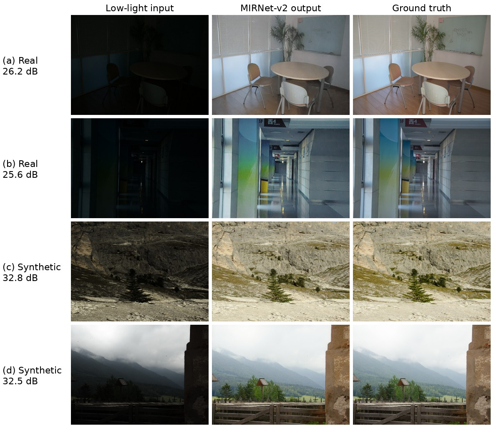
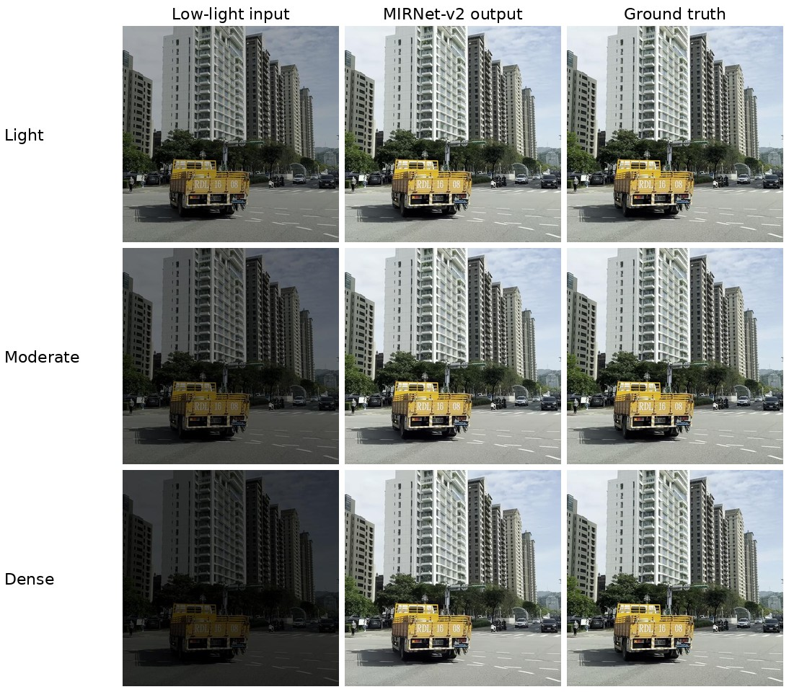
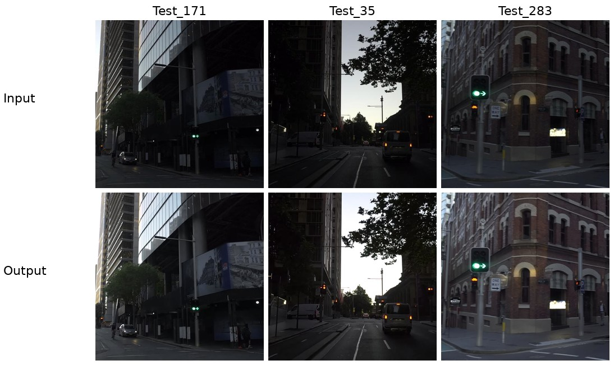

# Low-Light Image Enhancement with MIRNet-v2

PyTorch implementation of the **official MIRNet-v2** architecture (5.86 M parameters) for low-light image
enhancement, trained on the **LoLI-Street** street-scene dataset and on **LOL-v2** (real + synthetic).
Major Project, Phase-I - M.Tech Computational and Data Science, NITK Surathkal.



## Results

| Dataset | Split | Images | Input PSNR / SSIM | **MIRNet-v2 PSNR / SSIM / LPIPS** |
|---|---|---|---|---|
| LoLI-Street | Validation | 2,997* | 9.68 / 0.545 | **30.24 / 0.925 / 0.029** |
| LOL-v2 (real + synthetic) | Test | 200 | 10.47 / 0.323 | **21.61 / 0.860 / 0.114** |
| LOL-v2 real | Test | 100 | 9.72 / 0.196 | 19.53 / 0.804 / 0.162 |
| LOL-v2 synthetic | Test | 100 | 11.22 / 0.450 | 23.68 / 0.915 / 0.066 |

LoLI-Street per darkness level: light 32.14 dB, moderate 30.10 dB, dense 28.46 dB.
Inference: about 0.2 s per 512x512 image on an RTX 4000 Ada.

\* Three validation pairs (`*_30727`) are completely black and are excluded. With them, the score in
`results/lolistreet_val_summary.csv` is 30.31 dB.

| LoLI-Street validation (light / moderate / dense) | Real LoLI-Street test images (no reference) |
|---|---|
|  |  |

More: [best dense-level results](samples/lolistreet_val_dense_best.jpg) | [training curves](samples/training_curves.png)

## Repository layout

```
├── config.py              all settings (+ command-line overrides)
├── model_arch.py          official MIRNet-v2
├── losses.py              L1 + LPIPS + FFT-L1
├── data_loader.py         LoLI-Street loading, cropping, augmentation
├── data_loader_lolv2.py   LOL-v2 loading (real / synthetic / both)
├── utils.py               metrics, scheduler, checkpoints, CSV logging
├── train.py               training (mixed precision, gradient accumulation, resume)
├── evaluate.py            evaluation, saves enhanced images and metrics
├── pipeline.py            check -> train -> evaluate in one command
├── requirements.txt
├── models/                best weights (LoLI-Street and LOL-v2)
├── results/               training logs, metric summaries and configs
└── samples/               example results
```

## Setup

```
pip install -r requirements.txt
```
Datasets are not included. Place them as
```
DATASETS/LoLI-Street Dataset/{Train,Val}/{low,high}/   and   DATASETS/LoLI-Street Dataset/Test/
DATASETS/LOL-v2/{Real_captured,Synthetic}/{Train,Test}/{Low,Normal}/
```

## Usage

Enhance / evaluate with the provided weights:
```
python evaluate.py --dataset lolistreet --split val  --checkpoint models/mirnetv2_lolistreet_best.pth
python evaluate.py --dataset lolistreet --split test --checkpoint models/mirnetv2_lolistreet_best.pth
python evaluate.py --dataset lolv2 --lolv2_subset both --split test --checkpoint models/mirnetv2_lolv2_best.pth
```
Train from scratch:
```
python pipeline.py --dataset lolistreet --run_name my_run
python pipeline.py --dataset lolv2 --lolv2_subset both --run_name my_lolv2_run
```
Main settings: 256x256 patches, batch 4 x 3 accumulation steps (effective 12), AdamW, learning rate
2e-4 with 3 warm-up epochs and cosine decay to 1e-6, mixed precision, 100 epochs.

## References

- S. W. Zamir et al., "Learning Enriched Features for Fast Image Restoration and Enhancement" (MIRNet-v2), IEEE TPAMI, 2023.
- M. T. Islam et al., "LoLI-Street: Benchmarking Low-Light Image Enhancement and Beyond", ACCV 2024.
- W. Yang et al., "Sparse Gradient Regularized Deep Retinex Network for Robust Low-Light Image Enhancement" (LOL-v2), IEEE TIP, 2021.
